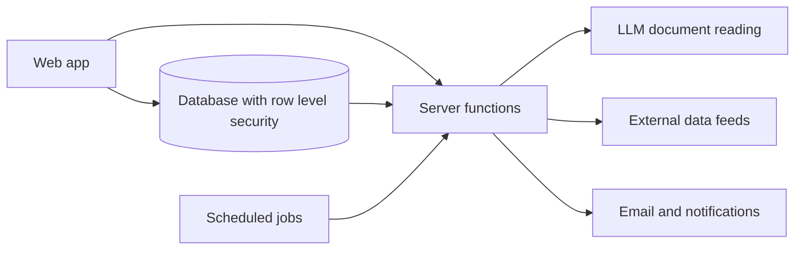

# BunkerIstanbul: engineering case study

[bunkeristanbul.com](https://bunkeristanbul.com) is a marine fuel (bunker) marketplace and a voyage and emissions compliance platform. I designed and built the whole system alone between February and November 2026: the product, the system logic, the data model, the security model and the domain rules. The code is private because it runs a live business, so this page gives an overview of what I built and the kind of problems I solved.

## The problem

When a ship needs fuel, the owner or broker usually sends enquiries to suppliers by email and messaging apps, collects offers in a spreadsheet and compares them by hand. After the voyage the same company has to report fuel and emissions to the EU and IMO, and these reports are still mostly built in Excel.

BunkerIstanbul puts both sides in one place:

- **Marketplace:** shipowners post enquiries, suppliers compete with offers, and the accepted deal moves through delivery and the delivery documents.
- **Voyage and compliance:** voyages, daily reports from the ship, an electronic log book and the EU and IMO emissions reports.
- **Free public tools:** emissions and voyage calculators and port price pages, in English and Turkish.

Users: shipowners, brokers, suppliers, crew on board and platform admins.

## Domain knowledge behind the design

I have a degree in maritime transportation and management and grew up around my family's ship owning business. The product logic comes from that experience, not from a template:

- **The deal flow follows how bunkers are really bought,** including the disputes and paperwork that come after delivery.
- **The compliance rules are built from the regulations themselves:** MARPOL Annex VI, ISO 8217 fuel specifications, CII, EU MRV, IMO DCS, EU ETS and FuelEU Maritime.
- **The ship side is designed for real conditions on board:** weak internet, logs that the office has to sign, ship time versus office time.
- **The app does not claim more than it can prove.** It shows a result only when the data supports it and says clearly what it is not certified for.

## Architecture (high level)

- **Frontend:** React and TypeScript, with offline support for the ship side.
- **Backend:** PostgreSQL with row level security on every table, server functions for business logic and integrations, scheduled background jobs.
- **AI:** LLM based reading of shipping documents, with cost limits and human review for anything uncertain.
- **Integrations:** vessel tracking, weather, sea routing and market price data, email and push notifications.
- **Public site:** prerendered pages for search engines in two languages.

## Size

| | |
|---|---|
| Commits | 1,100+ (Feb to Nov 2026, single author) |
| Database | 200+ tables, 500+ migrations, 1,000+ access policies |
| Routes | about 140, with 80+ public pages in English and Turkish |
| Tests | 1,000+ test files, about 15,000 automated tests |

## Problems I solved

**1. A data leak between companies.** While reviewing the access rules table by table, I found one table that every visitor could read, which exposed other companies' records. I closed it, checked the rest of the database for the same pattern, and then ran three planned security releases covering logs, secrets and rate limits.

**2. Duplicate records from ships with bad internet.** At sea a save can reach the server while the reply is lost, so the app retried and saved the same entry twice. I made every save safe to repeat, so a retry can never create a second record.

**3. A route planner that went over land.** Some calculated sea routes crossed land. I added a check on every route before it is used. One test route went from 439 nm over land to 612 nm on the real sea route.

**4. Accepting an offer safely.** Accepting an offer changes several things at once: the chosen offer, the competing offers, the deal and the buyer's credit. I made it a single all or nothing operation, and later closed a gap where an expired offer could still be accepted.

**5. Times saved three hours early.** Crew log entries were stored in the wrong time zone, three hours early on Turkish time. I fixed it so the web app and the phone app use the same ship clock.

**6. Not trusting AI output blindly.** When the AI reads a shipping document, a line is accepted automatically only if it passes strict checks. Everything else goes to a person.

## How I work

- **I design first.** Before a feature I write a plan: the flow, the data, who can see what, and what can go wrong.
- **I own the system logic.** The data model, the access rules, the transaction boundaries and the domain calculations are my decisions.
- **I find and fix my own bugs.** The problems above are real bugs from this project. I traced each one to its root cause and fixed it, and about 40% of all commits are fixes.
- **Nothing reaches production untested.** Every change goes through the test suite, and every important database change is tested against real data without saving anything, with a rollback ready before it goes live.
- **I use modern tools to move fast.** I use AI coding tools to write code faster, the same way I use a framework or a library. The design, the decisions and the responsibility for the result are mine.

## What I would do differently

- Add automated CI from day one.
- Write down architecture decisions as short decision records from the start.
- Keep the repository cleaner from the beginning.

## Contact

Eyüp Enes Atasoy, Istanbul · [LinkedIn](https://www.linkedin.com/in/eyup-enes-atasoy/) · [bunkeristanbul.com](https://bunkeristanbul.com)
